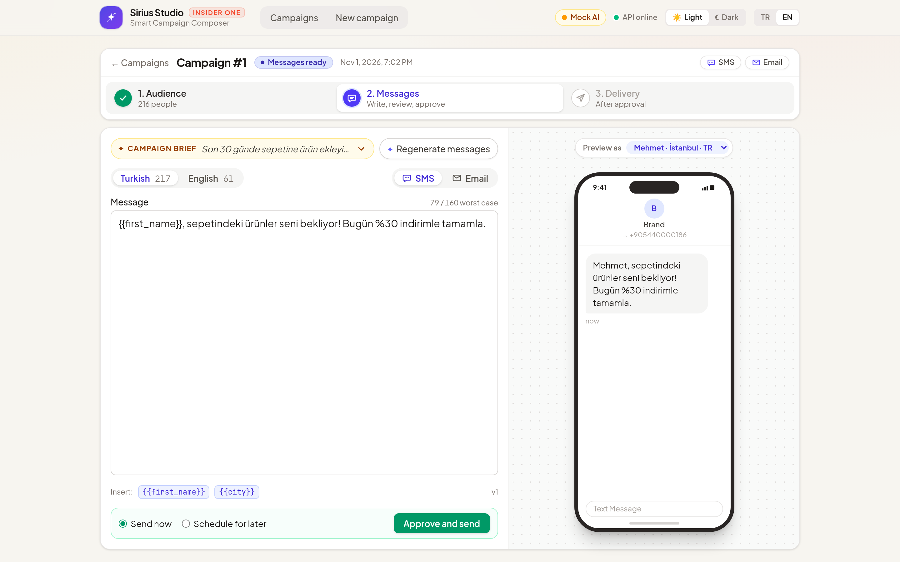
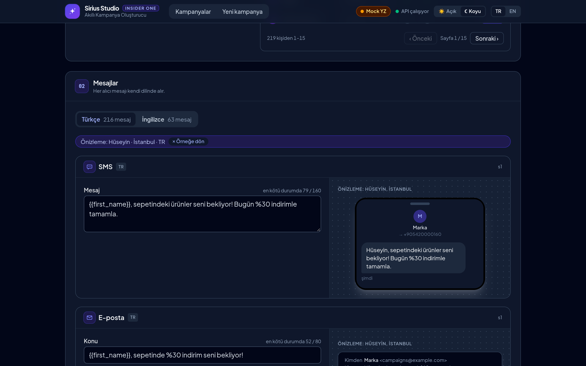

# Sirius Studio · Smart Campaign Composer
### Autonomous Multi-Channel Campaign & Delivery Engine for Insider One

[](https://github.com/oguzkarcan/smart-campaign-composer/actions/workflows/ci.yml)

A marketer writes a campaign brief in plain language. Claude turns it into a
target audience and SMS/email messages, the marketer reviews and approves them,
and the messages are sent through a queue to a mock provider while a dashboard
shows delivery status live.

> Insider One · AI Developer Case Study. No real messages are ever sent: all
> recipients are generated fake users and delivery goes to a local mock provider.

The web app is branded **Sirius Studio**. The Message Studio fits one desktop
screen: one channel's editor and the approval bar beside a live device preview,
here previewing the messages as one of the matching people. SMS in the warm
light theme (English interface), email in the dark theme (Turkish interface):

| Light · EN | Dark · TR |
| --- | --- |
|  |  |

## Quick start

Requirements: Docker with Compose. Nothing else (Go and Node run in Docker for
tests when they are not installed).

```sh
cp .env.example .env   # optional; everything has mock-mode defaults
docker compose up
```

Open http://localhost:3000. The header switches the interface language
(`TR | EN`) and the colour theme (light / dark, defaulting to dark until you
pick one); both are remembered in the browser.

| Service        | URL                           |
| -------------- | ----------------------------- |
| Frontend       | http://localhost:3000         |
| API            | http://localhost:8080/health  |
| Metrics        | http://localhost:8080/metrics |
| Mock provider  | http://localhost:9090/stats   |
| Postgres       | localhost:5432 (`scc`/`scc`)  |

Compose runs the migrations and seeds 5,000 fake users with 90 days of
events before the services start. `make down` removes the volumes, so the next
`up` starts from a fresh database.

### Using Claude instead of the mock

By default the app uses a deterministic **mock LLM**, so no API key is needed.
To use Claude, set these in `.env` and restart the API:

```sh
LLM_MODE=claude
ANTHROPIC_API_KEY=sk-ant-...        # never committed; .env is gitignored
CLAUDE_MODEL=claude-sonnet-5-5      # default
```

## Walkthrough

1. **New campaign:** write a brief, e.g. *"İstanbul'daki, son 30 günde
   sepetine ürün ekleyip satın almayan kullanıcılara %10 indirim hatırlatması
   gönder"*, and pick the channels (SMS, email or both). The example is one
   click away on the form.
2. **Audience:** the brief becomes a segment rule, shown as readable
   conditions ("Added to cart in the last 30 days", raw JSON on demand), with
   how many matched users consented to each channel, in total and per
   language (Turkish / English). Open *Show matching people* to see who the
   rule matches, with which channels each person receives or is skipped on
   (no consent); click *Name*, *City* or *Language* to sort (again to
   reverse) and page with *Previous* / *Next*. Pick anyone to preview the
   messages as that person.
   The list is read-only: the rule alone decides who is in it. Regenerate
   the audience if it is not what you meant.
3. **Messages:** generate content and watch it stream in, once per language
   in the audience: Turkish readers get Turkish messages, English readers
   English ones, each in its own tab. Edit any message; counters show its
   worst-case length after `{{first_name}}` / `{{city}}` are filled in with
   the longest values among that language's recipients, and problems are
   shown inline. If Claude's answer is invalid, it is asked to repair it (up to
   2 times) and the screen shows the repair round.
4. **Approve:** choose *Send now* or *Schedule for later* (up to 30 days
   ahead). The content is validated again against today's audience, locked,
   and one message per consented recipient and channel is queued, due now or
   at the scheduled time; a scheduled campaign waits as `scheduled` with a
   countdown and starts sending on its own.
5. **Delivery:** the dashboard follows the campaign live: counts per status
   and channel, throughput, retries and the most common failure reasons, until
   the campaign is `completed`. The mock provider injects 429s, 5xx errors and
   lost responses, so retries are visible.

## Commands

```sh
make test              # backend and frontend tests (mock LLM, no API key, no
                       # running stack needed)
make test-integration  # DB tests and the end-to-end delivery test against the
                       # seeded compose Postgres (needs `make up`; pauses the
                       # compose worker while it runs)
make vet               # go vet
make fmt               # go fmt
make up                # docker compose up --build
make down              # stop and remove volumes (fresh database next time)
make help              # list all targets
```

CI (GitHub Actions, `.github/workflows/ci.yml`) runs `make vet` and
`make test` on every push to `main` and every pull request.

Frontend development with hot reload (needs Node; the dev server proxies
`/api` to the API on :8080, override with `API_URL`):

```sh
docker compose up -d api worker             # backend stack
cd frontend && npm install && npm run dev   # http://localhost:3000
```

### What the tests prove

- **Unit (`make test`):**
  - *Segment DSL:* injection-like input (SQL in values, list items, ops,
    events, look-alike field names, wrong JSON types, absurd nesting) is
    rejected; every valid rule compiles to SQL with no literals, only
    placeholders; consent is applied outside the rule, so an `any` (OR) rule
    cannot bypass it.
  - *Content:* allowed variables only, every limit inclusive and counted in
    characters (not bytes) on the worst case after expansion; content per
    language (generated, edited and approved with that language's lengths,
    all languages or nothing).
  - *Scheduling:* `send_at` must be in the future and within 30 days; a
    scheduled approval queues the same messages and waits as `scheduled`.
  - *LLM:* validate-and-repair loop (success, repair, failure after 2
    repairs, every attempt recorded), the Claude client against a fake server
    (streaming, refusal, truncation, overload retries), the mock's answers.
  - *Delivery:* provider response classes and `Retry-After`, backoff and the
    5-attempt policy, the worker's rate limit (minimum pace, no window over
    the limit, independent per channel), retries, graceful shutdown.
  - *HTTP API* (including the paged, read-only recipients list) and the
    *frontend* (type check, rule rendering in English and Turkish, content validation mirror, SSE reader, progress maths, language
    tabs, schedule input, step bar, translations).
- **Integration (`make test-integration`):** compiled rules match a
  hand-written reference query on the seeded data; approval queues only
  consented recipients on the campaign's channels, exactly once, even under
  concurrent approvals; queue claiming, leases and stale results; a
  scheduled campaign is not claimed, started or closed before its time, and
  starts sending once due; the recipients list pages through exactly the
  rule's matches with their stored consent; audience counts and variable lengths per
  language, every queued message keeps its recipient's language, and the
  worker sends the content of that language.
- **End to end:** the real worker, Postgres queue and HTTP client against the
  mock provider with its 100/s limit and injected 429s, 5xx and lost
  responses, plus one recipient rejected with a 400. Every message ends sent
  or failed, the duplicate-delivery counter stays 0, every provider call is
  recorded, a permanent error fails at once, retries stop at 5 attempts,
  `Retry-After` is waited out, and the provider's own rate limit never fires.

## Architecture

```
            ┌──────────┐  SSE / REST  ┌───────┐   Claude API (or mock)
 browser ──▶│ frontend │─────────────▶│  api  │──────────────▶ LLM
            └──────────┘              └───┬───┘
                                          │ campaigns, messages (queue)
                                      ┌───▼──────┐
                                      │ Postgres │
                                      └───▲──────┘
                                          │ FOR UPDATE SKIP LOCKED
                                      ┌───┴────┐  100 msg/s per channel  ┌──────────────┐
                                      │ worker │────────────────────────▶│ mockprovider │
                                      └────────┘  retry + idempotency key└──────────────┘
```

- **frontend**: Vue 3 single-page app served by nginx, which also proxies
  `/api/*` to the API (same origin, no CORS; SSE unbuffered).
- **api**: campaign endpoints, LLM calls, SSE streams, `/health`, `/metrics`.
- **worker**: claims due messages from Postgres, rate-limits per channel,
  retries with backoff, recovers expired leases, closes finished campaigns.
- **mockprovider**: imitates an SMS/email provider with a real rate limit,
  idempotency keys and configurable 429s, 5xx, lost responses and latency.
- **seed / migrate**: one-shot jobs run by compose before the services start.

**Campaign lifecycle:** `draft` → `audience_ready` → `content_ready` →
(`scheduled` →) `sending` → `completed` / `failed`. Approval moves a campaign
to `sending`, or to `scheduled` with a `send_at`, in the same transaction that
queues its messages; the worker moves a scheduled campaign to `sending` when
its time comes.

**How the core rules are enforced:**

| Rule | Where |
| ---- | ----- |
| LLM output is never executed as SQL | Claude returns a JSON segment DSL (whitelisted fields, ops, catalog values); `segment` validates it and compiles it to parameterized SQL. |
| Invalid LLM output is repaired | `llm.Generate`: errors go back to Claude, max 2 repairs, every attempt in `llm_generations`. |
| Consent | Recipient queries are `WHERE (<rule>) AND <channel consent>`, only for the campaign's channels. |
| SMS ≤ 160, subject ≤ 80 | `content` checks the worst case after expansion with the audience's longest values; the database checks the raw template; the worker checks the rendered message. |
| Only content is editable | Strict request bodies; edits go through the same validator, and approval validates again. |
| 100 msg/s per channel | A token bucket per channel in the worker; the mock provider enforces the same limit. |
| No duplicates | `UNIQUE(campaign_id, user_id, channel)` with `ON CONFLICT DO NOTHING`; `messages.id` as the provider idempotency key. |
| Retries | 5 attempts, jittered exponential backoff (1 s base, 60 s cap), `Retry-After` on 429, no retry on permanent errors, 30 s lease recovery. |

See [DECISIONS.md](DECISIONS.md) for the reasoning behind every major choice.

## API

All bodies are JSON. Errors are `{"error": "...", "problems": [{"path", "message"}]}`;
`problems` lists validation failures by path (`sms.body`, `conditions[0].field`).

| Method & path                          | What it does |
| -------------------------------------- | ------------ |
| `POST /campaigns`                      | `{"brief", "channels": ["sms", "email"]}` → creates the campaign and generates its segment. `201` even if generation fails: the campaign stays `draft` with `last_error`. |
| `GET /campaigns/{id}`                  | Campaign with segment rule, audience counts, content, `variable_lengths` and `limits`. |
| `POST /campaigns/{id}/segment`         | Regenerates the segment (discards content). |
| `POST /campaigns/{id}/content`         | Generates content for every language in the reachable audience (`tr`, `en`), one after another, streamed as SSE: `delta` `{"language", "attempt", "text"}`, then `done` (campaign) or `error`. A new language or a higher `attempt` (a repair round) starts a new answer. Saved only if every language succeeds; problems carry the language (`en.sms.body`). Errors before streaming starts are plain JSON. |
| `PUT /campaigns/{id}/content/{language}/{channel}`| `{"subject", "body"}` → marketer edit of one language's message, validated like generated content with that language's lengths (`422` with `problems`). |
| `POST /campaigns/{id}/approve`         | Optional body `{"send_at": "<RFC 3339>"}`. Re-validates the content against today's audience (`422` if it no longer fits), locks it, queues one message per consented recipient and channel, status → `sending`, or `scheduled` until `send_at` (`scheduled_at` on the campaign). `400` if `send_at` is not in the future or more than 30 days ahead; `409` if not `content_ready`, edited meanwhile, or nobody is reachable. |
| `GET /campaigns`                       | Campaigns newest first with message counts. `?limit=` (1–200, default 50), `?before=<id>` for the next page. |
| `GET /campaigns/{id}/recipients`       | Users the segment rule matches now, ordered by id: `{"recipients": [{"id", "first_name", "city", "language", "phone", "email", "sms_consent", "email_consent"}], "total", "limit", "offset"}`. `?limit=` (1–100, default 15), `?offset=`, `?sort=id\|first_name\|city\|language` (names and cities in Turkish alphabetical order), `?order=asc\|desc`; ties by id. Read-only; consent is reported, not filtered. `409` before the campaign has a segment. |
| `GET /campaigns/{id}/progress`         | Delivery progress: message counts by status (`totals` and per channel), top failure reasons, `done`. |
| `GET /campaigns/{id}/events`           | SSE for the live dashboard: a `progress` event now and on every change; ends after one with `"done": true` (close the `EventSource` then). |
| `DELETE /campaigns/{id}/schedule`      | Cancels a scheduled campaign before it starts: its queued messages are removed and it goes back to `content_ready` (messages editable, approve again). `409` if it is no longer `scheduled`, its time has come, or a message was already claimed. |
| `POST /campaigns/{id}/send-now`        | Starts a scheduled campaign now: status → `sending`, its queued messages become due now, `scheduled_at` becomes the start time. `409` if it is no longer `scheduled` (e.g. the worker started it). |
| `GET /health`                          | `200` when the database is reachable, `503` otherwise. Also reports `llm_provider` (`claude` or `mock`) and `llm_model`, which the UI shows as a badge in the header. |
| `GET /metrics`                         | Prometheus text format: messages by channel/status, campaigns by status, provider calls by outcome and code, provider and LLM latency, LLM generations and tokens. |

Status codes: `400` bad input, `404` unknown campaign, `409` not allowed in the
campaign's status (e.g. after approval), `422` invalid content or model output,
`502` the LLM could not be reached.

**Live length counter:** `variable_lengths` (e.g.
`{"tr": {"first_name": 15, "city": 9}, "en": {...}}`) is, per language, what
each variable counts as in the server's worst-case check, measured on the
campaign's reachable audience who read that language; `languages` lists the
languages the campaign has or needs content for. A template's worst-case length is its length
with each `{{variable}}` replaced by that many characters; compare it with
`limits` (`{"sms.body": 160, "email.subject": 80, "email.body": 5000}`).

Example (needs `jq`; with the mock LLM this finishes in a few seconds):

```sh
id=$(curl -s localhost:8080/campaigns \
  -d '{"brief": "Users in Ankara who viewed a product this week", "channels": ["email"]}' | jq .id)
curl -sN -X POST localhost:8080/campaigns/$id/content   # SSE: delta events, then done
curl -s -X POST localhost:8080/campaigns/$id/approve   # or -d '{"send_at": "2026-11-02T09:00:00Z"}'
curl -sN localhost:8080/campaigns/$id/events            # SSE until "done": true
```

## Configuration

Every variable has a default, so `.env` is optional; see
[.env.example](.env.example).

| Variable | Default | Meaning |
| -------- | ------- | ------- |
| `LLM_MODE` | `mock` | `mock` (deterministic, no key) or `claude` |
| `ANTHROPIC_API_KEY` | – | required when `LLM_MODE=claude` |
| `CLAUDE_MODEL` | `claude-sonnet-5-5` | model for segment and content generation |
| `POSTGRES_HOST_PORT` | `5432` | host port for Postgres, if 5432 is taken |
| `MOCK_*` | see `.env.example` | mock provider rate limit, failure rates and latency |

## Repository layout

```
backend/
  cmd/{api,worker,mockprovider,seed}   one binary each, one Docker image
  internal/
    config/        environment configuration
    store/         Postgres connection
    segment/       audience rule DSL: validator, SQL compiler, consent
    content/       message content: validation, worst-case length, rendering
    llm/           LLM interface, prompts, repair loop, Claude and mock clients
    campaign/      campaign flow: brief → segment → content → edit → approve
    delivery/      provider client, retry policy, Postgres queue, worker
    metrics/       Prometheus text exposition
    httpapi/       HTTP routes, SSE, error mapping
    seed/          deterministic fake users and events
    mockprovider/  fake SMS/email provider
  migrations/      SQL schema (golang-migrate)
frontend/          Vue 3 + Vite + TypeScript + Tailwind app
  src/api/         typed API client, SSE reader
  src/lib/         i18n (TR/EN), segment rule → readable text, content
                   validation mirror, schedule, steps, progress
  src/components/  audience, step bar, editors and previews, dashboard
  src/views/       pages (campaign list, new campaign, campaign)
ai-sessions/       Claude Code session exports (paths and personal data scrubbed)
```

## Status

Everything in the case's core scope works end to end: brief → segment →
audience counts → streamed content with validation and repair → edits →
approval → rate-limited, retried, idempotent delivery → live dashboard, plus
`/health`, `/metrics`, a mock LLM and a mock provider, all from one
`docker compose up`.

Beyond the core scope (Day 6): scheduled sending (`send_at` on approval,
with "send now" and "cancel schedule" while it waits),
messages in each recipient's language (Turkish / English, generated,
edited and sent per language), and a marketer-oriented UI with a `TR | EN`
interface switch, light / dark themes, a campaign page split into Audience,
Messages and Delivery steps, a Message Studio that fits one screen on desktop
(one channel editor, approval bar and device preview side by side) and a
read-only list of matching people to preview the messages as.

### Unfinished scope and known gaps

- **Consent is checked when messages are queued, not again when they are
  sent.** A user who withdraws consent while a campaign is sending still
  receives its message. Re-checking consent in the worker's claim query
  would close this.
- **Two message languages, `tr` and `en`,** fixed in code and in the
  schema. A third language needs a `CHECK` change, a label and a mock
  template; the flow itself is generic.
- **SMS length is 160 characters, not 160 GSM-7 units.** Turkish letters
  force UCS-2, where one SMS segment holds 70 characters. We follow the
  case's rule; a real sender would count segments.
- **One worker process.** The rate limiter is in-process; running several
  workers would need a shared limiter (Postgres or Redis). Claiming itself
  is already safe across processes.
- **Metrics are aggregates read at scrape time.** Fine at this scale; with
  millions of messages they would become counters or a summary table.
- **No pause or cancel of a sending campaign** (a scheduled one can be
  cancelled back to editing, or sent now), no direct rescheduling (cancel
  and approve again), no campaign deletion, no quiet hours or per-recipient time
  zones. A scheduled campaign's recipients are fixed at approval, not at its
  send time.
- **No authentication or multi-tenancy;** the API trusts its caller.
- **The segment rule cannot be edited by hand,** by design: the marketer
  edits the brief and regenerates.
- **LLM:** no prompt caching (the prompts are below the cacheable size) and
  no API structured outputs (our validator is the source of truth); either
  could cut cost or repair rounds.
- **Mock provider state is in memory:** restarting it forgets idempotency
  keys.
- **Frontend tests are unit tests and type checks;** there are no browser
  end-to-end tests.
- **Interface language covers the UI's own text.** The `TR | EN` switch
  translates labels, statuses, rule descriptions, dates and numbers; error
  and validation messages written by the API stay in English.
- **No A/B variants yet.** Design: a campaign gets up to N variants per
  language and channel (`campaign_contents.variant`, e.g. `A`/`B`, each
  validated like today's content, with a traffic share that sums to 100).
  At approval each recipient is assigned with a stable hash,
  `bucket = hash(campaign_id, user_id) mod 100`, mapped onto the shares,
  and the variant is stored on the message (`messages.variant`) like its
  language, so retries and re-enqueues always send the same variant and
  the split is reproducible without storing a random seed. A holdout is
  just a variant that is never sent. The dashboard and `/metrics` group by
  variant; measuring conversions would join `user_events` purchases after
  `sent_at` per variant. Hashing on `user_id` (not `messages.id`) keeps a
  user in the same arm across channels.
- **Claude mode has not been run against the live API.** The demo and all
  tests use the mock LLM; the Claude client is tested against a fake
  streaming server (`llm/claude_test.go`: streaming, refusal, truncation,
  overload retries) but was not exercised with a real key.
